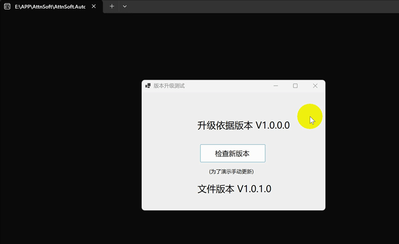

# AttnSoft.AutoUpdate


AttnSoft.AutoUpdate 是一款轻量级、易于使用、跨平台的应用程序自动升级组件。

## 快速开始

#### 客户端使用
##### Windows环境
在您的主项目中安装AttnSoft.AutoUpdate NuGet包,根据需要按照如下示例代码配置即可

示例代码：

1) 系统默认为OSS方式获取版本信息:
```csharp
UpdateContext? context = new UpdateContext()
{
    UpdateUrl = "http://update.attnsoft.com/demo/v1/version.json"
};
await UpdateApp.CreateBuilder(context).StartUpdateAsync();
```
2) 启用WebApi方式获取版本信息:
```csharp
UpdateContext? context = new UpdateContext()
{
    UpdateUrl = "http://127.0.0.1:5000/Verification"
};
context.UseWebApi();
await UpdateApp.CreateBuilder(context).StartUpdateAsync();
```
升级组件内部会向UpdateUrl发送Post请求,获得版本信息.

3) 自定义方式获取版本信息:
```csharp
UpdateContext? context = new UpdateContext()
{
    UpdateUrl = "http://127.0.0.1:5000/Verification"
};
context.UseWebApi();
context.OnGetUpdateVersionInfo += (context) =>
{
    var uri = new Uri(context.UpdateUrl);
    using var httpClient = new HttpClient();
    httpClient.DefaultRequestHeaders.Authorization =
        new System.Net.Http.Headers.AuthenticationHeaderValue("Authorization", "tokenxxx");
    string postData = $"{{\"Version\": \"{context.ClientVersion}\", \"AppKey\": \"{context.AppSecretKey}\"}}";
    var stringContent = new StringContent(postData, Encoding.UTF8, "application/json");
    var result = await httpClient.PostAsync(uri, stringContent);
    var responseJsonStr = await result.Content.ReadAsStringAsync();
    return JsonSerializer.Deserialize<List<VersionInfo>>(responseJsonStr);
};
await UpdateApp.CreateBuilder(context).StartUpdateAsync();
```

##### Linux环境
请使用源码编译方式:
```
git clone https://github.com/liaiwu/AttnSoft.AutoUpdate.git
```

1. 编译AttnSoft.AutoUpdate并在主项目中引用
2. 编译AttnSoft.Upgrade项目。
根据具体使用环境选择相应的linux平台,并将生成的Upgrade可执行文件与主程序放到同一个目录下。
3. 代码使用与上述Windows环境一致


#### 服务端配置
本组件支持两种存储版本信息的方式:
1. OSS:在文件服务器(对象存储服务)上配置Version.json文件,用来描述发布的版本信息.
2. WebApi:组件通过Web服务的方式获取版本信息.

以上两种方式提供的版本信息都是json格式的，具体内容如下:
```json
[
    {
        "recordId": 1,
        "version": "1.0.0.0",
        "requiredMinVersion": "",
        "url": "http://update.attnsoft.com/demo/v1/WinAppClient.zip",
        "hash": "SHA256",
        "startAppCmd": "WinAppClient",
        "isForcibly": false,
        "desc": "Introduction to the new version features.",
        "releaseDate": "2025-01-15T09:23:19",
        "updateLogUrl": null,
        "blackFileFormats": [ ".patch", ".zip", ".rar", ".tar", ".pdb" ],
        "blackFiles": [],
        "skipDirectorys": [ "app-", "fail" ]
    }
]
```
#### 补丁包制作

可以根据补丁包的大小选择如下两种方式:
1. 全量更新：
如果补丁包不大的话,可以直接将要更新的文件用压缩工具生成单一ZIP格式的文件即可。
2. 差异更新：
如果补丁包很大的话,可以采用差异更新方式制作补丁包以减少补丁包的大小。
可以使用GeneralUpdate提供的[工具包](https://github.com/GeneralLibrary/GeneralUpdate.Tools.git)制作。

#### 进程管理

组件内置进程管理机制，确保升级过程可靠：

- **升级器残留清理**：主程序在启动 Upgrade 前自动检测并结束应用目录下残留的升级器进程（防止上次升级失败导致的冲突）
- **多进程自动关闭**：升级器在执行安装前自动扫描应用目录下所有运行中的进程并逐一结束，支持多进程架构应用（如主进程 + 子进程）的无缝升级
- **防误杀机制**：通过进程名和主模块路径双重校验，避免误杀其他目录下的同名进程
- **跨平台兼容**：Windows 和 Linux 平台均支持，进程名匹配自动处理扩展名差异

### WinAppClient运行示例


此示例演示了winform下程序升级过程。

## 日志

组件只**产生**日志、不**决定**日志去向：默认写入 `System.Diagnostics.Trace`，Release 构建同样可见，不重定向 `Console.Out`、不写任何文件。最快的一行接入是交给宿主的日志框架：

```csharp
context.UseMicrosoftLogging(loggerFactory);   // Serilog / NLog / Console 均可，.NET 6 及以上
```

日志级别与输出接口直接采用 Microsoft.Extensions.Logging 的 `LogLevel` / `ILogger`，全部目标框架（含 .NET Framework 4.6.1）写法一致。五种拦截方案的对比与适用框架、类型来源与 net461 撞名条件、`Upgrade.exe` 的落盘位置、从 3.x 的迁移方式，见 [docs/LOGGING.md](docs/LOGGING.md)。

## 支持框架

| .NET框架名称               | 是否支持 |
| -------------------------- | -------- |
| .NET Framework 4.6.1       | 支持     |
| .NET 6.0                   | 支持     |
| .NET 8.0                   | 支持     |
| .NET 10.0                  | 支持     |

目标框架就是上表这四个（`net461;net6.0;net8.0;net10.0`）。不在其中的框架——含 .NET Core 2.0/3.1、
.NET 5/7/9，以及 3.5.0 起已移除的 netstandard2.0——安装时会报 `NU1202`。

#### .NET Framework 4.6.1 的注意事项

Framework 版升级器 `Upgrade.exe` 解析版本信息要用 Newtonsoft.Json，而它是以**单个 exe** 嵌入核心库、
释放到安装目录的，不带任何依赖项。所以**安装目录必须已有 `Newtonsoft.Json.dll`**，否则升级器启动时会抛
`FileNotFoundException: 未能加载文件或程序集 "Newtonsoft.Json"`。多数 .NET Framework 应用本就带着它；
没有的话把该 dll 放进安装目录即可。失败原因会记在 `{安装目录}\upgrade_logs\upgrade.log`，
症状见 [docs/LOGGING.md](docs/LOGGING.md)。

**宿主程序的 target framework 要 ≥ 4.6** 才能下到 https 的升级包。.NET Framework 的默认 TLS 版本
由**宿主应用**的 target 决定（不是本组件的 4.6.1）：≥4.6 默认就含 TLS 1.2，而 target ≤4.5.2 默认不含，
对端只接受 TLS 1.2 时**握手阶段就失败**，与证书无关。本组件不设 TLS 协议版本——`HttpWebRequest` 与
`ServicePoint` 在 .NET Framework 上都没有实例级的 `SecurityProtocol` 属性，唯一的开关
`ServicePointManager.SecurityProtocol` 是**进程级全局**的，会污染宿主里其他组件，本包不碰。
宿主若 ≤4.5.2，请自行把宿主 target 提到 4.6 以上，或在宿主启动时自己设
`ServicePointManager.SecurityProtocol`。

### 开源链接
Github: https://github.com/liaiwu/AttnSoft.AutoUpdate.git

Gitee:  https://gitee.com/attnsoft/AttnSoft.AutoUpdate.git

## 更新日志

完整更新日志见 [docs/CHANGELOG.md](docs/CHANGELOG.md)。NuGet 包的 `PackageReleaseNotes` 也只放这个页面的链接，不再单独维护一份。

## 感谢

项目中GeneralUpdate命名空间下的代码均来源于[GeneralUpdate](https://github.com/GeneralLibrary/GeneralUpdate.git)项目。非常感谢GeneralUpdate团队的开源贡献。

